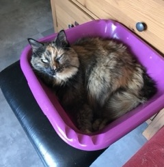

# La chasse aux unités

**30 minutes — En binôme**

## Consignes

Remplacer les tailles fixes (`px`) par des unités relatives et observer
comment la page réagit **quand on redimensionne la fenêtre** ou **qu'on zoome**.

Testez chaque modification en :

- Redimensionnant la fenêtre du navigateur
- Utilisant le zoom du navigateur (Ctrl + / Ctrl −)

> **Questions à se poser :**
> 
> - Quelle unité suit la taille de police de référence ?
> - Quelle unité suit la largeur du parent ?
> - Quelle unité suit la largeur de la fenêtre ?
> - Pourquoi `rem` est-il préférable à `px` pour l'accessibilité ?

## 0 - Redimensionner la fenêtre, zoomer, dézoomer

Avant de changer le CSS.

1. Redimensionner la fenêtre, zoomer, dézoomer. 
2. Que peut-on observer ?
3. Qu'est-ce qui change ?
4. Qu'est-ce qui ne change pas ?

## 1 - Taille de police du body

1. Remplacer la taille de police du `<body>` (`16px`) par **`1rem`**
2. Redimensionner la fenêtre, zoomer, dézoomer. Que peut-on observer ?
3. Remplacer la taille de police du `<body>` (`1rem`) par **`1.5rem`**
4. Qu'est-ce qui ne change pas ? Pourquoi ?

## 2 - Largeur du conteneur

1. Remplacer la largeur du conteneur (`800px`) par **`100%`**
2. Pourquoi y-a t'il une barre de défilement horizontale ?
3. Ajouter une déclaration CSS au conteneur pour corriger le problème

Indice

## 3 - Marge du conteneur

1. Remplacer la marge du conteneur (`40px`) par **`2rem`**
2. Quelle est la correspondance en pixel ?
3. Comment décomposer le calcul cette taille ?

## 4 - Taille du titre

1. Remplacer la taille du titre (`32px`) par **`2rem`**

## 5 - Items de listes

1. Remplacer la taille du texte des éléments de liste `<li>` (`1.5 rem`) par `1.5rem` (sans espace)
2. Que se passe-t-il comment pourrait-on éviter ce type d'erreur ?
3. Remplacer la taille du texte des éléments de liste `<li>` (`1.5rem`) par `1.5em`
4. Que se passe-t-il ? 
5. Pourquoi ?
6. Quelle est la correspondance en pixel ?
7. Comment décomposer le calcul cette taille ?

## 6 - Dimensions 

1. Donner au conteneur une largeur de **`90vw`**
2. Redimensionner la fenêtre, zoomer, dézoomer. Qu'est-ce qui change ?
3. Remplacer la largeur du conteneur par **`min(90%, 60rem)`**
4. Redimensionner la fenêtre, zoomer, dézoomer. Qu'est-ce qui change ?

